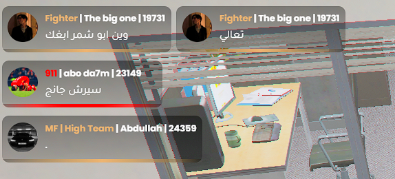
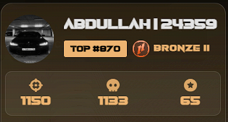
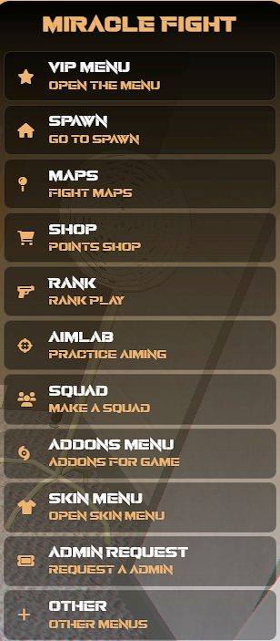
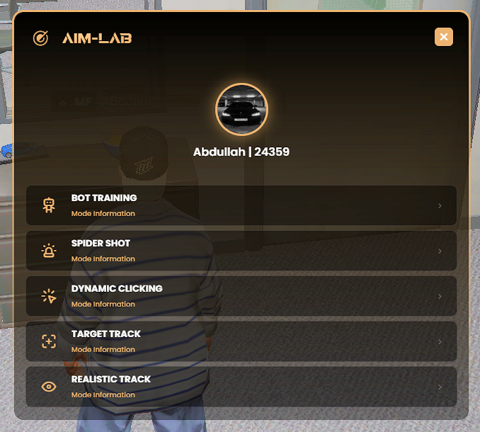
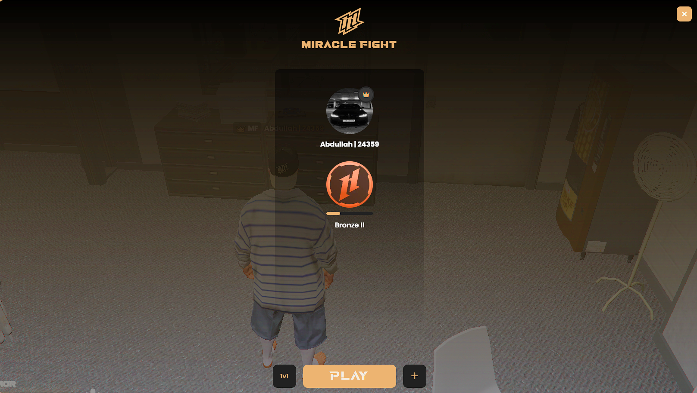
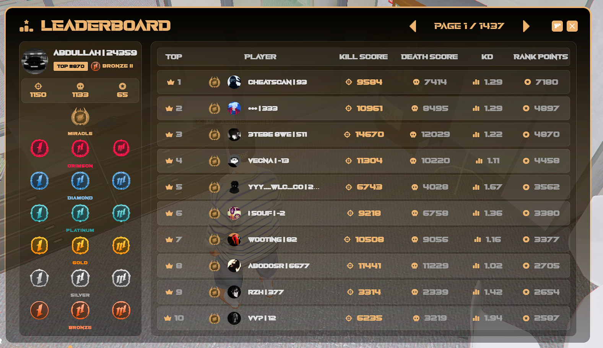
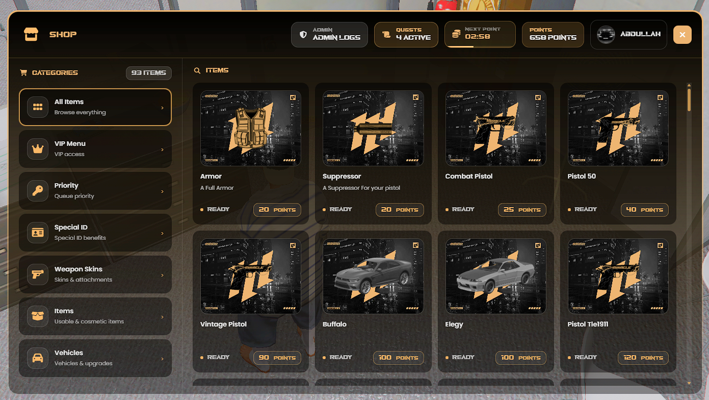

<!--
  Notes for Abdullah (these comments don't show on GitHub):
  - Put your screenshots in an /assets folder using the file names below,
    or change the paths to match your files.
  - Fill in the Contact section at the bottom.
  - Optional: add one specific detail to the F1 Menu, Rank System and
    In-Game Shop descriptions (see the comments under each).
-->

# Miracle Fight

**A high-performance FiveM PvP server built on QBCore, where I served as co-owner and developer through three seasons.**

> **Note:** The server's source code is private. This repository documents my role, the work I contributed, and the technical challenges involved.

---

## Overview

Miracle Fight is a FiveM PvP server that began on **September 4, 2024** and has run for **three seasons**. Much of the server runs on **custom scripts designed and developed** by our development team. Performance was a core priority from day one, and the server is known as **one of the lightest PvP servers in FiveM**, with most of our custom scripts running at just **0.01–0.02 ms** on resmon.

The server has **hit full player capacity with an active queue many times**.

| | |
|---|---|
| **Role** | Co-owner & Developer (Sep 2024 – 2026), now High Team member |
| **Launched** | September 4, 2024 |
| **Seasons** | 3 |
| **Framework** | QBCore |
| **Languages** | Lua, JavaScript, HTML, CSS |

---

## My Role

As co-owner and part of the development team, I worked on both the **technical side** and the **direction of the server**:

- **Custom script development:** wrote custom scripts and features in Lua and JavaScript as part of the dev team
- **Codebase maintenance and improvement:** updated, debugged and refactored the server's resources, including our own custom scripts, to keep them reliable as the server grew
- **Performance optimization:** reworked code to cut resource usage, in line with the server's focus on being lightweight
- **UI development:** built in-game interfaces (NUI) with HTML, CSS and JavaScript, wired to Lua game logic
- **Season launches:** helped prepare and ship content and updates across three seasons

In 2026 I stepped back from day-to-day duties to focus on my studies. I'm now part of the server's **High Team**, keeping the same access without active admin, staff or development responsibilities.

---

## Performance Work

Keeping the server light was a team-wide priority, and most of our custom scripts run at **0.01–0.02 ms** on resmon. We achieved this by:

- **Reducing client-side loops:** replacing constant per-frame loops with longer waits, distance checks, or event-driven logic
- **Moving logic server-side:** validating actions on the server instead of trusting the client, which improves both security and consistency
- **Cleaning up unused resources and dependencies** to lower load and startup time
- **Optimizing database queries** so data is loaded and saved efficiently
- **Monitoring with resmon** to find and fix the heaviest resources

---

## Custom Systems

The server runs on a set of advanced custom systems designed, built and continuously improved by our development team. As part of that team, I contributed across many of these systems, from writing new features to debugging, refactoring and optimizing existing ones.

### Discord ↔ FiveM Integration
Links each player's Discord account to their in-game identity. Players' **Discord profile pictures appear across most of the server's interfaces**, giving the UI a personalized, connected feel.



### Custom ID System
An advanced in-game ID system that replaces the standard txAdmin IDs, which makes managing players much easier. It also gives players a unique feel, because each ID is permanently tied to their account.



### F1 Menu
A central in-game hub that gives players quick access to the server's features from a single custom interface.



### Aim Lab
An in-game aim training system that lets players practice and sharpen their aim without leaving the server, built specifically for a competitive PvP environment.



### Rank System
A competitive progression system that ranks players based on their performance in fights.



### Leaderboard System
Live leaderboards that track and display top players, tying into the rank system to drive competition.



### In-Game Shop
A custom shop system with its own interface, letting players browse and purchase items directly in-game.




---

## Tech Stack

- **Lua:** server- and client-side game logic
- **JavaScript / HTML / CSS:** NUI interfaces (menus, HUDs, panels)
- **QBCore:** core framework
- **SQL:** persistent data storage
- **Discord API:** account linking and profile pictures inside in-game interfaces

---

## Architecture

FiveM resources are split into layers, and most of my work involved connecting and optimizing them:

```
┌──────────────┐   NUI messages   ┌──────────────┐   Events/Callbacks   ┌──────────────┐
│  NUI (UI)    │ ◄──────────────► │  Client Lua  │ ◄──────────────────► │  Server Lua  │
│ HTML/CSS/JS  │                  │ (per player) │                      │ (authority)  │
└──────────────┘                  └──────────────┘                      └──────┬───────┘
                                                                               │
                                                                        ┌──────▼───────┐
                                                                        │   Database   │
                                                                        └──────────────┘
```

- **NUI** handles everything the player sees and clicks
- **Client scripts** handle local game interaction and send requests to the server
- **Server scripts** validate requests, apply game rules, and read/write the database

---

## Challenges & What I Learned

**Keeping a full PvP server lightweight**
PvP servers are especially sensitive to performance, because frame drops and lag directly affect fights. Running near full capacity meant every resource had to be efficient, so I learned to profile resources, find what was actually costing performance, and rework it without breaking gameplay.

**Developing and maintaining a shared custom codebase**
Working as part of a dev team meant writing code that others would build on, and extending and debugging code written by teammates. I got comfortable reading and refactoring code quickly, tracking down bugs across interconnected resources, and making changes without breaking other systems.

**Shipping across multiple seasons**
Each season brought new content and updates. That meant testing changes carefully and keeping the server stable for an active player base during and after updates.

---

## Contact

**Abdullah Alshammary**
[GitHub profile link] · [Email or Discord]
